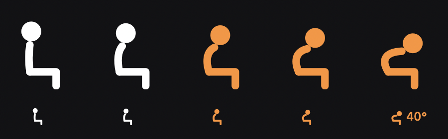
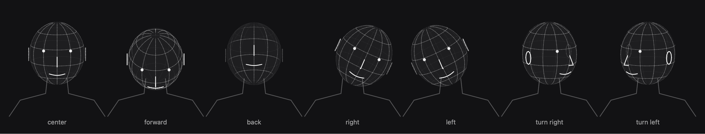
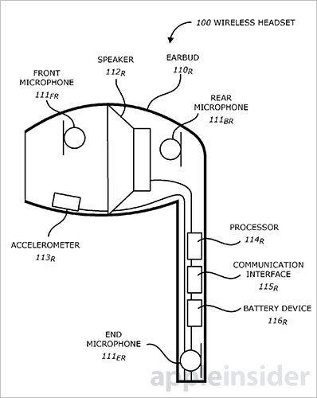

# posture

[posture.crafter.run](https://posture.crafter.run)

Your AirPods already know when you slouch. **posture** reads their head tracking sensor and nudges you when your head drops for too long. A menu bar app with a live figure and stats, plus a CLI built for scripts and agents.



- **Live menu bar figure** that bends with your head and turns orange while you slouch
- **Nudge after 30 seconds** of bad posture, a soft tick when you sit back up
- **Guided setup** with a 3D head that learns which way is forward, back and sideways for your AirPods
- **Stats**: daily score, time slouched, nudges, best upright streak, hour by hour and the week
- **Range of motion** for your neck in degrees, measured during setup
- **CLI with JSON** for everything, including a live JSONL stream
- **Local only**. No account, no network, data lives in `~/.config/posture`

## Requirements

- macOS 15 or newer (building from source also needs Xcode command line tools)
- AirPods Pro, AirPods 3 or newer, AirPods Max, or Beats Fit Pro (anything with spatial audio head tracking)

## Install

```sh
npm install -g @crafter/posture
posture bar
```

Prebuilt for Apple Silicon and Intel, no Xcode needed. `posture bar` opens the menu bar app that ships inside the package. Allow Motion & Fitness access and notifications when macOS asks.

From source instead:

```sh
git clone https://github.com/crafter-station/posture
cd posture
scripts/install.sh
```

## Guided setup



On first launch a setup window walks you through six moves while a 3D head shows what to do and a ring fills as you follow:

1. Look down, then up
2. Ear to the right shoulder, then the left, eyes ahead
3. Turn right, then left, chin level
4. Sit how you like to work and hold still. That becomes your reference.

Each move teaches posture an axis in your AirPods' frame and is checked: nod during a side tilt or tip your chin while turning and it asks you to redo it. At the end the head mirrors you live and you see your range of motion.

Run it again any time from **Calibrate** in the menu bar panel, or choose **Only recalibrate posture** to just reset how you sit.

## CLI

```sh
posture                  # watch live in the terminal
posture now              # one reading, exit 0 upright, 1 slouching
posture stats --days 7   # score, slouch time, streak, nudges, today by hour
posture config --threshold 12 --grace 45
posture calibrate        # reset your upright position from the terminal
posture doctor           # AirPods, permission, sensor, calibration, directions
posture bar              # open the menu bar app
```

Every command takes `--json`. `posture watch --json` streams one line per second:

```json
{"at":"2026-10-25T22:41:03Z","degrees":17,"direction":"forward","event":"sample","pitch":17,"roll":-2,"slouching":true,"streak":412}
```

plus `nudge`, `disconnected` and a final `summary` event. While the menu bar app is running the CLI is view only, so time is never counted twice.

## How it works



<sub>The accelerometer inside each earbud (113) is what posture reads. Diagram from an Apple patent, via AppleInsider.</sub>

The AirPods fuse their accelerometer and gyroscope into a gravity vector in the earbud's own frame, about 50 times a second. Setup records your upright gravity vector and learns three rotation axes from the guided moves. Every reading is compared to the reference and split into **forward/back** and **left/right**.

- Head drops forward past the threshold (15° by default): slouching
- Tilts sideways past the threshold plus 5°: slouching
- Leans back: never counts
- Turning to look at another screen: ignored, gravity does not change when you turn

Hold it for the grace period (30 seconds by default) and you get a notification. Nudges repeat at most every 90 seconds.

**What it can't see.** The sensor measures rotation, not position. Pushing your chin forward while keeping your eyes level, or slumping your back with your head level, are not detected. In practice most slouching comes with a head drop. If you reseat your AirPods and readings drift, recalibrate.

**Why the CLI respawns itself.** macOS attributes a CLI's privacy requests to the terminal, which has no motion usage description, so CoreMotion aborts the process. `posture` relaunches itself with the terminal's responsibility disclaimed, so the request is made under its own embedded `Info.plist`.

## Project layout

```
Sources/PostureKit   sensor, tilt math, learned axes, tracker, storage
Sources/posture      CLI
Sources/PostureBar   menu bar app, setup flow, 3D head, stats panel
scripts/             bundle.sh builds Posture.app, install.sh from source, npm-build.sh the npm package
www/                 landing page at posture.crafter.run (Next.js)
```

Builds are ad hoc signed, so macOS asks for motion access again after each rebuild.

## License

MIT, released with [Crafter Station](https://github.com/crafter-station).

Built with 💛 by [Cris](https://www.cris.fast)
